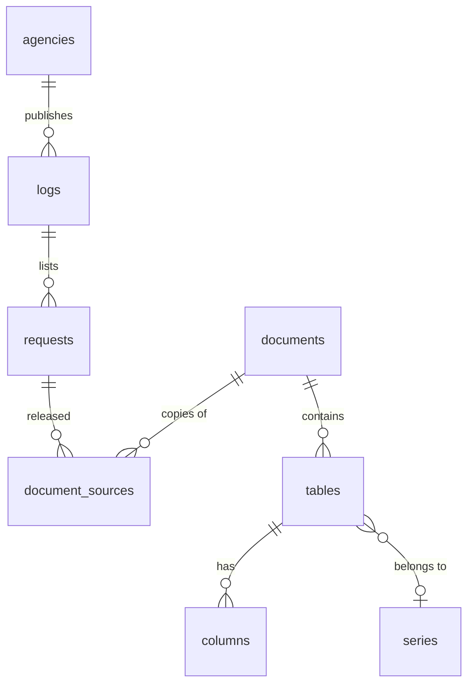

# Data model

How the archive and the extracted tables fit together, and what every column means. The catalogue is
rebuilt from the pipeline's own files, so it never drifts from the data:

```
python -P scripts/build_catalogue.py          # ~10 s; writes data/catalogue/*.csv and catalogue.duckdb
python -P scripts/build_catalogue.py --log dss-main   # one log and its agency, for reviewing a change
```

Rebuild after any harvest, survey or extraction run. The CSVs are the master copy; `catalogue.duckdb` is
rebuilt from them for querying with SQL joins (DuckDB, not arrow: arrow segfaults under Git Bash).

## Shape



- One **agency** can have several **logs** (current and archived pages, portfolio logs).
- A **request** is one entry in a log: one FOI decision.
- A **document** is one unique file, keyed by its sha256. The same file reached through two logs or two
  harvests (phase 1 and the all-agency run, or a log wrongly attributed to another agency) is ONE document
  with several rows in `document_sources`. On 8 October 2026, 4,475 of 11,935 documents had more than one copy.
  Count documents from `documents`, never from `document_sources` or the raw folders.
- A **table** is one extracted table (one CSV). `columns` is the data dictionary of every table's columns.
- A **series** is the same table published again (another month, year or release).

## Tables

### agencies (`agency_slug`)
From the Australian Government Organisations Register (AGOR, 30 June 2026) plus discovery.

| column | meaning |
|---|---|
| agency_slug | key; lower-case name with hyphens |
| agency, portfolio, website | as in AGOR |
| type_of_body | AGOR type (A. non-corporate, B. corporate, C. company) |
| staff_asl | AGOR average staffing level; blank where AGOR has none (DSS is blank in AGOR) |
| agor_id | AGOR identifier |
| foi_page_url | the FOI page discovery found (for ANAO this is an audit report, not an FOI page) |

### logs (`log_slug`, → agencies)
| column | meaning |
|---|---|
| log_slug | key; also the manifest name `data/manifest_<log_slug>.csv` and usually the raw folder `data/raw/<log_slug>/` (phase 1 logs differ: `dss-main` documents are in `data/raw/dss/`) |
| agency_slug | → agencies; for logs harvested under the wrong agency, the agency whose website hosts the log (see `note`) |
| how_found, robots_ok | how discovery found the log; whether robots.txt allowed the log page |
| note | registry notes, plus `reattributed from ...` or `log host ... matches no agency` |
| log_url | the disclosure log page (or `web.archive.org` for `dss-wayback`) |
| discovery_status | found_log, blocked, robots_disallowed, ... from the registry |
| harvest_status, harvested_at | from `data/registry/harvest_status.csv` |
| n_requests | requests in the catalogue for this log |

Phase 1 sources are mapped onto logs: `dss` and `dss_detail` -> `dss-main`, `servicesaustralia` ->
`servicesaustralia-log`, `dss_wayback` -> `dss-wayback` (Internet Archive copies of the old DSS log).

### requests (`request_id`, → logs)
| column | meaning |
|---|---|
| request_id | key; hash of log + normalised FOI reference ("FOI_LEX_56712" = "FOI LEX 56712"), or of the log entry when there is no reference |
| foi_reference | as printed in the log |
| title | request title (phase 1 parsed title where available; otherwise the log entry's text) |
| release_date | as printed; formats vary |
| release_date_iso | YYYY-MM-DD; blank when absent or not a real date (outside 1982..today, e.g. "2025-26-26", "6 May 1958") |
| log_slug | → logs |
| decision | access decision where the log gives one |
| n_documents | unique documents downloaded for it; 0 = released by email, not online, or not downloaded |

### document_sources (→ requests, → documents)
One row per copy: `request_id`, `doc_id`, `log_slug`, `local_path` (repo-relative), `doc_url`, `bytes`.

### documents (`doc_id` = sha256)
| column | meaning |
|---|---|
| ext | file extension |
| bytes | file size from the manifest |
| pages | PDF pages (pdftotext) |
| scanned_pages | pages with under 100 characters of text: image only, need vision |
| text_table_lines | lines with 2+ numeric cells in `pdftotext -layout`: a sign of extractable text tables |
| class | `pdf: scanned/image only` (half or more pages scanned), `pdf: has numeric tables` (10+ table lines), `pdf: some numbers` (3-9), `pdf: text, no tables`, `word`, `other`, `not surveyed` (log not surveyed yet) |
| n_tables | extracted tables from this document |
| n_sources | copies on disk |
| example_path | one local copy |

Survey source: `data/survey/survey_phase1.csv`, `survey_agencies.csv`, `survey_dss_wayback.csv`.
`survey_docs.csv` (the first one-off survey) is NOT read: its `scanned` column is a 0/1 flag, not a page count.

### tables (`table_id`, → documents)
| column | meaning |
|---|---|
| table_id | key; hash of the CSV path |
| doc_id | → documents |
| method | `pdfplumber` (text layer, no independent check) or `vision` (scanned page, transcribed and checked) |
| pages | PDF page(s); `;`-separated when a table spans pages |
| table_n | n-th table on the page |
| title | vision: printed title or a description; pdfplumber: the first row, often data rather than a title |
| units | vision only: what the numbers are |
| n_rows, n_cols | data rows (header excluded), columns |
| caption | text-layer tables: a printed "Table N: ..." line found just above the table, else blank |
| check_status | vision: `pass` / `flag` from `vision_tools.py verify` (why: `data/extract/vision/<batch>/flag_sort.csv`); pdfplumber: `text layer (no check)` |
| csv_path | the table, repo-relative |

### columns (→ tables) — the data dictionary of every extracted table
| column | meaning |
|---|---|
| position, column | column order and name as in the CSV |
| type | `number` (80%+ numeric), `label` (20% or less), `mixed` |
| filled_share | share of cells not blank, `-`, `n/a` or `redacted` |
| numeric_share | share of filled cells that are numbers |
| example | first filled value |
| dimension | the shared breakdown the column carries, judged on its VALUES: state, financial_year, year, month, lga, electorate, payment_type, age_group, sex. These are the columns tables can be joined on. Blank = none detected |
| year_in_name | `yes` when a year sits in the column NAME (`lodged_2019_20`): a wide table that needs reshaping before it joins on year |

### series (→ tables)
| column | meaning |
|---|---|
| series_id | key of the group |
| table_id, doc_id, title | the member table, its document and its title |
| agency_slug | series never cross agencies |
| title_key | the title with dates, numbers and table labels removed: what was matched |
| n_tables, n_documents | size of the group (2+ documents, or it is a repeat, not a series) |
| confidence | `high` (same title and same columns) or `medium` (same title, columns differ): medium groups need a human check |

Vision tables only: pdfplumber "titles" are usually a data row.

### facts (→ tables) — one row per number, with its breakdowns
Built by `python -P scripts/build_facts.py` after `build_catalogue.py`; vision tables, the FOI LEX 55799 clean table, and
text-layer (pdfplumber) tables that pass a quality filter (see `layout`).
Rules agreed with Pete on 8 October 2026: a period not in any column is taken from the title (`period_from`
says where it came from); derived numbers the agency printed are kept and marked; suppressed or nil cells get
a blank `value`, the printed text in `value_raw` and a `flag`, never 0; tagged breakdowns use shared names;
modelled numbers are kept with `kind = modelled`. Tables with a cleaned version (`scripts/clean_*.py`, listed
in `CLEAN` in build_facts.py) contribute facts from the clean table instead of their raw pages.

| column | meaning |
|---|---|
| fact_id | table_id:csv line:column position (or `clean:<file>:<line>:<column>`) |
| table_id, csv_line, column | where the number sits |
| measure | what is counted, from the column name with periods and stat words removed (rule-based, not standardised across tables) |
| stat | `value`, `percent`, `pct change`, `difference` |
| derived | `yes` when the agency computed it from other numbers (% of total, % change, difference), judged from the column name. Printed totals are marked by `is_total`, not here |
| is_total | `yes` on printed total rows or columns: exclude before summing |
| period, period_type, period_from | e.g. `2019-20` / financial_year / column name; `2011-06` / month / title; `2006-06-30` / date; `2019-20 to 2020-21` / change. period_from is `column name`, `row label`, `title`, `units` or `clean table`; blank when no period is known. A bare year column follows the table's June wording: "year ended 30 June 2010" is 2009-10, "at 30 June 2006" is the date 2006-06-30 |
| geography, geography_type | state, lga or electorate value and which |
| category, category_type | the main row breakdown (shared name such as payment_type, else the table's column name) |
| other_dims | further breakdowns as `name=value; ...` (e.g. `sector=School; group=Age; category=Under 18`) |
| value | the number, cleaned (no $ , %; brackets made negative) |
| value_raw | as printed |
| flag | `nil` (printed -), `blank`, `redacted`, `not published`, `below threshold` (<5, <1%), `text` |
| unit | `%` for percentages, otherwise from the table's units |
| kind | `reported` or `modelled` (worked examples, projections, policy scenarios) |
| check_status | the table's checker status: are the DIGITS right |
| layout | is the MEANING known: `checked` (any vision table: transcribed with a title and units and run through the checker; it does not test that the title is informative), `labelled` (text-layer table, header found, measure known), `captioned` (a printed "Table N: ..." title says what the table is, but not what each column measures), `context needed` (digits right, but what they count is not on record: the title or headings sit outside the extracted grid) |

State on 8 October 2026: 167,855 facts from 2,540 tables. Vision: 62,411 from 886 tables (`checked`).
pdfplumber: 1,662 of 7,506 text-layer tables kept (3+ rows, 2+ columns, 30%+ numeric; the rest are
fragments), header = leading rows that are mostly text or years (up to 3, merged per column); 17,380 facts
`labelled`, 88,064 `context needed`. Captions (`scripts/table_captions.py`, the text just above each
table) were tried the same day: only 118 of 1,654 are real "Table N" titles; the rest is page furniture
("Commercial-in-confidence 33", "Page 107"), prose or the previous table's numbers. 73 tables moved to
`captioned`; 85,826 facts in 1,226 tables stay `context needed`. The free route is used up: naming those
needs a model reading the page (one Haiku pass after the harvest, with the measure tidy). Known gaps: 21,555
facts have no period, mostly 109 FOI LEX 55799 tables outside the clean table (month is in the page header)
and the 12/13-037 policy scenarios (no period by nature); `measure` wording varies table to table.

## Queries

```sql
-- every table with its full lineage
SELECT * FROM table_lineage WHERE agency = 'Department of Social Services' AND method = 'vision';
-- tables that can be joined on electorate
SELECT DISTINCT l.table_title, l.foi_reference, l.release_date_iso
FROM table_lineage l JOIN columns c USING (table_id) WHERE c.dimension = 'electorate';
-- how much scanned material each agency holds (unique documents only)
SELECT a.agency, sum(CAST(d.scanned_pages AS INT)) AS scanned_pages
FROM documents d JOIN (SELECT DISTINCT doc_id, log_slug FROM document_sources) s USING (doc_id)
JOIN logs l USING (log_slug) JOIN agencies a USING (agency_slug) GROUP BY 1 ORDER BY 2 DESC;
```
(`tables` is a table name here; don't use it as a column alias, DuckDB rejects that.)

## Known issues (8 October 2026)

- Only DSS and Services Australia documents have been extracted; other agencies' tables come after the harvest.
- `dss-main` shows 210 requests with no document where the log says about 135 were released by email: the
  other ~73 are probably all-agency-run entries whose FOI reference did not match phase 1's. Not checked yet.
- Logs harvested under the wrong agency before the registry fix (ANAO -> PMC, Treasury, Infrastructure;
  ARENA -> DCCEEW) are credited in `logs` to the agency whose website hosts them (`note` says "reattributed").
  DTA's log on a pre-production site is marked, not moved.
- Director of National Parks shares DCCEEW's disclosure log (its website is a page on dcceew.gov.au), so the
  same 785 documents count under both agencies in per-agency totals. Undecided whether Parks should be a
  separate agency or folded into DCCEEW; count unique documents (`documents`) for any total.
- One FOI reference holds a broken character from the source manifest (`19/20-001 �`).
- Dimension tags are rule-based. They catch the common breakdowns; LGA and electorate rules need a reference
  list of names to be complete.
- Wide tables are reshaped only in `facts`. Text-layer facts carry a known risk: a Haiku spot-check (8 October
  2026, `data/reviews/haiku_labelled_facts.md`) found 2 of 34 locatable `labelled` values taken from the
  neighbouring column under a merged heading. Vision facts passed 40 of 40 (`haiku_checked_facts.md`).
